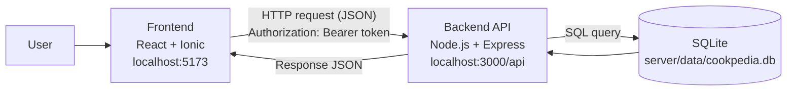
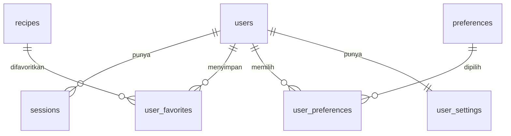
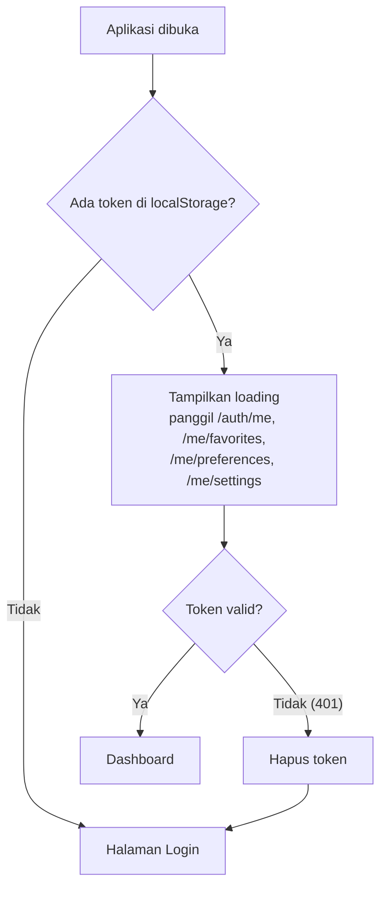
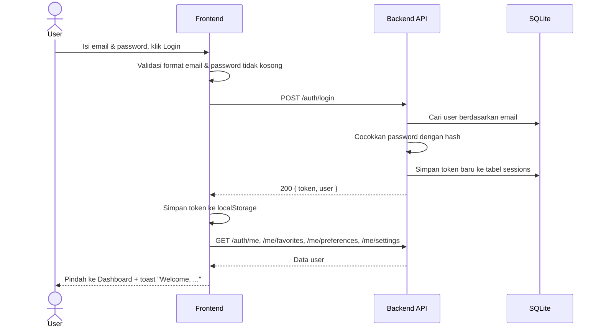

# Cookpedia

Cookpedia adalah aplikasi mobile resep masakan. User bisa melihat daftar resep, mencari dan memfilter resep per kategori, membuka detail resep, menyimpan resep favorit, dan mengatur preferensi akun.

Project ini terdiri dari dua bagian:

| Bagian | Folder | Fungsi |
|---|---|---|
| **Frontend** | `src/` | Tampilan aplikasi (React + Ionic), bisa dijalankan di browser atau di Android lewat Capacitor |
| **Backend (API)** | `server/` | REST API buatan sendiri (Node.js + Express) dengan database SQLite |

Frontend tidak menyimpan data secara permanen. Semua data akun, resep, favorit, preferensi, dan settings diambil dari dan disimpan ke API.

---

## Daftar isi

1. [Teknologi yang digunakan](#1-teknologi-yang-digunakan)
2. [Struktur folder](#2-struktur-folder)
3. [Arsitektur](#3-arsitektur)
4. [Cara menjalankan](#4-cara-menjalankan)
5. [Dokumentasi API](#5-dokumentasi-api)
6. [Database](#6-database)
7. [Frontend](#7-frontend)
8. [Alur aplikasi](#8-alur-aplikasi)
9. [Pengujian](#9-pengujian)
10. [Catatan dan keterbatasan](#10-catatan-dan-keterbatasan)

---

## 1. Teknologi yang digunakan

### Frontend

| Teknologi | Versi | Kegunaan |
|---|---|---|
| React | 19 | Library untuk membangun tampilan |
| Ionic React | 9 | Komponen UI mobile (halaman, modal, toggle, toast, alert) |
| React Router | 6 | Navigasi antar halaman |
| Capacitor | 8 | Membungkus aplikasi web menjadi aplikasi Android |
| Vite | 8 | Development server dan build tool |
| Ionicons | 8 | Ikon |

### Backend

| Teknologi | Kegunaan |
|---|---|
| Node.js (22.13 atau lebih baru, diuji dengan v26) | Menjalankan kode JavaScript di sisi server |
| Express 5 | Framework untuk membuat route API |
| SQLite (`node:sqlite`, bawaan Node.js) | Database berbentuk satu file, tanpa perlu install server database |
| CORS | Mengizinkan frontend (port berbeda) memanggil API |
| `node:crypto` (bawaan Node.js) | Hash password (scrypt) dan pembuatan token login |

Backend **tidak membutuhkan XAMPP atau MySQL**. Database SQLite tersimpan sebagai file `server/data/cookpedia.db` dan dibuat otomatis saat server pertama kali dijalankan.

### Tools pengujian

| Tools | Kegunaan |
|---|---|
| Postman | Menguji endpoint API secara manual |
| Cypress 13 | Pengujian end-to-end alur login, logout, dan sign up di browser |

---

## 2. Struktur folder

```
myApp-v2.0/
├── public/
│   └── images/                  Gambar resep dan foto profil
├── src/                         FRONTEND
│   ├── App.jsx                  Daftar route dan pembagian halaman berdasarkan status login
│   ├── main.jsx                 Titik masuk aplikasi React
│   ├── variables.css            Tema warna
│   ├── services/
│   │   └── api.js               Semua pemanggilan ke API
│   ├── components/
│   │   ├── AppContext.jsx       State global: user, token, resep, favorit, settings
│   │   ├── RecipeCard.jsx
│   │   ├── FeaturedRecipeCard.jsx
│   │   ├── RecipeDetailModal.jsx
│   │   ├── FavoritesListModal.jsx
│   │   ├── SettingsModal.jsx
│   │   ├── BottomNav.jsx
│   │   └── ImageWithFallback.jsx
│   └── pages/
│       ├── Login.jsx            Login dan Sign up
│       ├── Dashboard.jsx        Daftar resep, pencarian, kategori
│       └── Profile.jsx          Profil, favorit, settings, logout
├── server/                      BACKEND (API)
│   ├── package.json             Dependency backend (terpisah dari frontend)
│   ├── data/
│   │   └── cookpedia.db         Database SQLite (dibuat otomatis, tidak di-commit)
│   └── src/
│       ├── index.js             Semua route API
│       ├── db.js                Skema tabel, seed data awal, fungsi createUser
│       ├── seedData.js          Data awal resep & preferensi (untuk mengisi database)
│       ├── auth.js              Hash password dan pembuatan token
│       └── middleware.js        requireAuth (cek token di header)
├── cypress/
│   └── e2e/auth-flow.cy.js      Tes end-to-end alur autentikasi
├── .env.example                 Contoh konfigurasi alamat API
└── package.json                 Dependency frontend
```

**Kenapa folder `server` ada di dalam project frontend?**
Supaya frontend dan backend bisa dikelola dalam satu repository. Keduanya tetap berjalan terpisah: `server/` punya `package.json` dan `node_modules` sendiri, dan tidak ikut di-build oleh Vite. Frontend dan backend tidak lagi berbagi file. Data resep dan preferensi awal ada di `server/src/seedData.js`, dan dipakai server untuk mengisi database.

---

## 3. Arsitektur



1. User berinteraksi dengan aplikasi (frontend).
2. Frontend mengirim request HTTP ke API lewat `src/services/api.js`.
3. Untuk data milik user (favorit, settings, dll.), frontend menyertakan token login di header `Authorization`.
4. API memeriksa token, menjalankan query ke SQLite, lalu mengirim balik respons JSON.
5. Frontend menyimpan hasilnya di `AppContext` dan menampilkannya di layar.

---

## 4. Cara menjalankan

> Panduan singkat untuk install di PC baru (beserta solusi masalah umum) ada di [CARA-INSTALL.md](CARA-INSTALL.md).

### Prasyarat

- **Node.js 22.13 atau lebih baru** (cek dengan `node -v`)
- npm

### Langkah 1: Install dependency

Install dependency frontend dan backend. Keduanya perlu, karena masing-masing punya `package.json` sendiri.

```bash
# Dari folder utama project
npm install

# Dependency backend
cd server
npm install
```

### Langkah 2: Jalankan backend

```bash
cd server
npm run dev
```

Jika berhasil, terminal menampilkan:

```
Cookpedia API running at http://localhost:3000
```

Saat pertama kali dijalankan, server otomatis membuat file database, tabel, data resep, data preferensi, dan akun demo.

> Membuka `http://localhost:3000` di browser akan menampilkan `{"error":"Route not found."}`. Itu normal, karena semua endpoint berada di bawah `/api`. Coba buka `http://localhost:3000/api/recipes`.

### Langkah 3: Jalankan frontend

Buka **terminal kedua** (backend harus tetap berjalan), lalu dari folder utama project:

```bash
npm run dev
```

Buka alamat yang ditampilkan Vite, biasanya `http://localhost:5173`.

### Langkah 4: Login

Gunakan akun demo:

| Email | Password |
|---|---|
| `ernest@mail.com` | `password123` |

Atau klik **Sign up** untuk membuat akun baru.

### Konfigurasi alamat API (opsional)

Secara default frontend memanggil `http://localhost:3000/api`. Untuk mengubahnya, salin `.env.example` menjadi `.env`:

```bash
VITE_API_URL=http://localhost:3000/api
```

| Menjalankan di | Isi `VITE_API_URL` |
|---|---|
| Browser di laptop | `http://localhost:3000/api` |
| Emulator Android | `http://10.0.2.2:3000/api` |
| HP asli (satu jaringan Wi-Fi) | `http://<IP-laptop>:3000/api` |

Setelah mengubah `.env`, hentikan lalu jalankan ulang `npm run dev` di frontend.

### Reset database

Hentikan server, hapus file `server/data/cookpedia.db`, lalu jalankan server lagi. Database baru dibuat dengan data awal.

---

## 5. Dokumentasi API

**Base URL:** `http://localhost:3000/api`

Semua request dan respons menggunakan format JSON.

### Autentikasi

API memakai **Bearer token**. Token didapat dari respons `login` atau `register`, lalu dikirim di header pada setiap request yang membutuhkan login:

```
Authorization: Bearer <token>
```

Token disimpan di tabel `sessions` dan berlaku sampai user logout.

### Daftar endpoint

#### Auth

| Method | Endpoint | Perlu token | Keterangan |
|---|---|---|---|
| POST | `/auth/register` | Tidak | Membuat akun baru |
| POST | `/auth/login` | Tidak | Login, mengembalikan token |
| POST | `/auth/logout` | Ya | Menghapus token di server |
| GET | `/auth/me` | Ya | Data user yang sedang login |

#### Resep

| Method | Endpoint | Perlu token | Keterangan |
|---|---|---|---|
| GET | `/recipes` | Tidak | Daftar resep, dengan filter dan pagination |
| GET | `/recipes/featured` | Tidak | Resep unggulan (Chef's Recommendation) |
| GET | `/recipes/:id` | Tidak | Detail satu resep |
| GET | `/categories` | Tidak | Daftar kategori |

Parameter untuk `GET /recipes`:

| Parameter | Contoh | Keterangan |
|---|---|---|
| `category` | `Dinner` | Filter kategori |
| `difficulty` | `Easy` | Filter tingkat kesulitan |
| `q` | `nasi` | Cari di nama dan deskripsi |
| `page` | `1` | Halaman (default 1) |
| `limit` | `20` | Jumlah per halaman (default 20, maksimal 50) |

#### Data user (semua perlu token)

| Method | Endpoint | Body | Keterangan |
|---|---|---|---|
| PATCH | `/me` | `{"name": "...", "avatar": "...", "favoriteCategory": "..."}` | Ubah profil (semua field opsional) |
| GET | `/me/favorites` | — | Daftar resep favorit |
| POST | `/me/favorites` | `{"recipeId": "rec-pancake"}` | Tambah favorit |
| DELETE | `/me/favorites/:recipeId` | — | Hapus favorit |
| GET | `/me/preferences` | — | Daftar preferensi beserta status `selected` |
| PATCH | `/me/preferences/:id` | `{"selected": true}` | Ubah satu preferensi |
| GET | `/me/settings` | — | Ambil settings |
| PATCH | `/me/settings` | `{"pushNotifications": true, "soundEffects": false, "emailDigest": true}` | Ubah settings (semua field opsional) |

### Contoh request dan respons

**Register**

```http
POST /api/auth/register
Content-Type: application/json

{
  "name": "Javier",
  "email": "javier@mail.com",
  "password": "pw12345"
}
```

Respons `201 Created`:

```json
{
  "token": "d1da5e7be6124619a6c73af59137038b8fcd16a0ece74664341a169d9e976212",
  "user": {
    "id": "5a0c8a66-7554-4b31-a432-94510834a21d",
    "name": "Javier",
    "email": "javier@mail.com",
    "avatar": null,
    "favoriteCategory": null,
    "memberSince": "Oct 2026"
  }
}
```

**Login**

```http
POST /api/auth/login
Content-Type: application/json

{
  "email": "ernest@mail.com",
  "password": "password123"
}
```

Respons `200 OK`: sama dengan register (berisi `token` dan `user`).

**Daftar resep**

```http
GET /api/recipes?category=Dinner&limit=2
```

Respons `200 OK`:

```json
{
  "data": [
    {
      "id": "rec-ayam-goreng-bawang-putih",
      "name": "Ayam Goreng Bawang Putih",
      "category": "Dinner",
      "description": "Ayam goreng renyah dengan bumbu bawang putih...",
      "cookingTime": "30 mins",
      "difficulty": "Easy",
      "rating": 4.8,
      "calories": "380 kcal",
      "servings": 3,
      "image": "/images/recipes/ayam_goreng_bawang.jpeg",
      "ingredients": ["500g Ayam potong (paha & dada)", "..."],
      "instructions": ["..."],
      "isFeatured": false
    },
    { "...": "resep kedua" }
  ],
  "page": 1,
  "limit": 2,
  "total": 4
}
```

**Tambah favorit**

```http
POST /api/me/favorites
Authorization: Bearer <token>
Content-Type: application/json

{ "recipeId": "rec-pancake" }
```

Respons `201 Created`:

```json
{ "recipeId": "rec-pancake", "favorited": true }
```

### Kode status

| Kode | Arti | Contoh penyebab |
|---|---|---|
| 200 | Berhasil | GET atau PATCH berhasil |
| 201 | Data berhasil dibuat | Register, tambah favorit |
| 204 | Berhasil tanpa isi respons | Logout, hapus favorit |
| 400 | Request tidak valid | Field wajib kosong, password kurang dari 6 karakter, tipe data salah, JSON rusak |
| 401 | Belum login / token tidak valid | Header `Authorization` tidak ada, token sudah logout, email atau password salah |
| 404 | Tidak ditemukan | ID resep atau preferensi tidak ada, route salah |
| 409 | Konflik | Email sudah terdaftar |
| 500 | Error di server | Kesalahan yang tidak terduga |

Semua respons error memakai format yang sama:

```json
{ "error": "Pesan error" }
```

---

## 6. Database

Database SQLite berada di `server/data/cookpedia.db`. Skemanya didefinisikan di `server/src/db.js`.



| Tabel | Isi |
|---|---|
| `users` | Akun user: nama, email, hash password, avatar, kategori favorit, tanggal bergabung |
| `sessions` | Token login yang masih aktif |
| `recipes` | Data resep. `ingredients` dan `instructions` disimpan sebagai teks JSON |
| `user_favorites` | Pasangan user dan resep favoritnya |
| `preferences` | Daftar pilihan preferensi (Spicy, Halal, Quick, dll.) |
| `user_preferences` | Preferensi mana yang dipilih tiap user |
| `user_settings` | Push notification, sound effects, email digest tiap user |

**Data awal (seed):**
- Resep dan preferensi diambil dari `server/src/seedData.js`, hanya jika tabelnya masih kosong.
- Akun demo `ernest@mail.com` dibuat jika belum ada.
- Setiap user baru otomatis mendapat preferensi default dan settings default.

**Keamanan password:** password tidak disimpan dalam bentuk asli. Server menyimpan hasil hash `scrypt` dengan salt acak dalam format `salt:hash`.

**Melihat isi database:** buka file `cookpedia.db` dengan [DB Browser for SQLite](https://sqlitebrowser.org/) atau extension VS Code "SQLite Viewer". Sebaiknya hanya untuk membaca data saat server sedang berjalan.

---

## 7. Frontend

### Halaman

| Halaman | File | Isi |
|---|---|---|
| Login / Sign up | `src/pages/Login.jsx` | Form login. Tombol **Sign up** mengganti form menjadi pendaftaran (nama, email, password) |
| Dashboard | `src/pages/Dashboard.jsx` | Sapaan, pencarian, filter kategori, Chef's Recommendation, daftar resep |
| Profile | `src/pages/Profile.jsx` | Data user, jumlah favorit, kategori favorit, tanggal bergabung, menu favorit, settings, logout |

Modal yang dipakai: detail resep (`RecipeDetailModal`), daftar favorit (`FavoritesListModal`), dan settings (`SettingsModal`).

### Komponen penting

**`src/services/api.js`**
Tempat semua pemanggilan API. Fungsi `request()` menambahkan header JSON dan token, lalu mengubah respons error menjadi `ApiError` yang berisi pesan dan kode status. Jika server tidak bisa dihubungi, muncul pesan "Cannot reach the server".

**`src/components/AppContext.jsx`**
State global aplikasi, dipakai semua halaman lewat `useApp()`:

| State / fungsi | Keterangan |
|---|---|
| `user`, `isAuthenticated`, `isAuthChecking` | Data user dan status login |
| `login()`, `register()`, `logout()` | Autentikasi |
| `recipes`, `recipesLoading`, `recipesError`, `reloadRecipes()` | Data resep dari API |
| `favorites`, `toggleFavorite()`, `isFavorite()`, `getFavoriteRecipes()` | Favorit |
| `preferences`, `togglePreference()` | Preferensi |
| `settings`, `updateSettings()` | Settings |
| `updateProfile()` | Ubah profil |
| `showToast()`, `hideToast()` | Notifikasi singkat |

Beberapa perilaku penting:
- **Token disimpan di `localStorage`** dengan key `cookpedia_token`, sehingga user tetap login setelah halaman di-refresh.
- **Update optimis**: saat favorit, preferensi, atau settings diubah, tampilan langsung berubah. Jika server gagal menyimpan, perubahan dibatalkan dan muncul pesan error.
- **Token tidak berlaku (401)**: sesi lokal dihapus dan user diarahkan ke halaman login.
- **Avatar**: user tanpa foto mendapat avatar berisi huruf depan namanya.

**`src/App.jsx`**
Route dibagi menjadi tiga kelompok sesuai status login:

| Status | Route yang tersedia |
|---|---|
| Belum login (`guest`) | `/login`. URL lain diarahkan ke `/login` |
| Sedang memeriksa token (`checking`) | Halaman loading |
| Sudah login (`user`) | `/dashboard`, `/profile`. URL lain diarahkan ke `/dashboard` |

Setiap kelompok punya `IonRouterOutlet` sendiri dengan `key` berbeda. Ionic menyimpan halaman yang pernah dibuka di memori; tanpa `key`, halaman lama bisa tersangkut setelah logout lalu login lagi (URL berubah tetapi layar tidak berganti). Dengan `key`, outlet dibuat ulang setiap status login berubah.

---

## 8. Alur aplikasi

### Membuka aplikasi



Daftar resep (`GET /recipes`) dimuat saat aplikasi dibuka, terpisah dari data user.

### Login



Jika email atau password salah, API mengembalikan `401` dan pesan error ditampilkan di form login.

### Sign up

1. User klik **Sign up** di halaman login, lalu form berubah menjadi form pendaftaran.
2. User mengisi nama, email, dan password (minimal 6 karakter).
3. Frontend mengirim `POST /auth/register`.
4. Server membuat user, preferensi default, dan settings default, lalu mengembalikan token.
5. User langsung masuk ke Dashboard tanpa perlu login lagi.
6. Jika email sudah terdaftar, muncul pesan `Email is already registered.`

### Menambah / menghapus favorit

1. User menekan ikon bookmark di kartu resep atau di detail resep.
2. Ikon langsung berubah (update optimis).
3. Frontend mengirim `POST /me/favorites` atau `DELETE /me/favorites/:recipeId`.
4. Jika berhasil, muncul toast. Jika gagal, ikon dikembalikan seperti semula dan muncul pesan error.

### Mengubah settings

1. User membuka **Profile → Settings** dan menggeser toggle.
2. Toggle langsung berubah, lalu frontend mengirim `PATCH /me/settings`.
3. Jika gagal, toggle dikembalikan ke posisi sebelumnya.

### Logout

1. User klik **Log Out** di Profile, lalu konfirmasi.
2. Frontend menghapus token dari `localStorage` dan mengosongkan data user.
3. Frontend mengirim `POST /auth/logout` sehingga token juga dihapus di server.
4. User kembali ke halaman login.

---

## 9. Pengujian

### Postman

1. Buat collection `Cookpedia API`.
2. Di tab **Variables** collection, buat:
   - `baseUrl` = `http://localhost:3000/api`
   - `token` = (kosong)
3. Buat request **Login** (`POST {{baseUrl}}/auth/login`) dengan body JSON berisi email dan password.
4. Di tab **Scripts → Post-response** request Login, tambahkan script berikut supaya token tersimpan otomatis:

   ```javascript
   pm.collectionVariables.set("token", pm.response.json().token);
   ```

5. Untuk request yang membutuhkan login, buka tab **Authorization**, pilih **Bearer Token**, isi `{{token}}`.
6. Buat request untuk setiap endpoint di [bagian 5](#5-dokumentasi-api).

Urutan uji yang disarankan:

1. Get recipes, Get featured, Get recipe detail, Get categories (tanpa login)
2. Register akun baru
3. Login
4. Get me
5. Add favorite → Get favorites → Remove favorite
6. Get preferences → Toggle preference
7. Get settings → Update settings
8. Update profile
9. Logout → Get me lagi (harus `401`)

### Cypress (end-to-end)

Tes `cypress/e2e/auth-flow.cy.js` menjalankan alur: login akun demo → logout → sign up akun baru → logout → login akun baru → refresh → pindah ke Profile dan kembali ke Home.

Backend dan frontend harus sedang berjalan, lalu jalankan:

```bash
npx cypress run --spec cypress/e2e/auth-flow.cy.js
```

> Jika dijalankan dari terminal VS Code dan muncul error `bad option: --smoke-test`, jalankan dengan `env -u ELECTRON_RUN_AS_NODE npx cypress run --spec cypress/e2e/auth-flow.cy.js` (Git Bash). Terminal VS Code membawa variabel `ELECTRON_RUN_AS_NODE` yang membuat Cypress gagal start.

Setiap kali tes dijalankan, satu akun `cy...@mail.com` dibuat di database.

---

## 10. Catatan dan keterbatasan

- **Token tidak punya masa kedaluwarsa.** Token hanya berhenti berlaku saat user logout.
- **Pencarian dan filter di Dashboard dilakukan di sisi frontend**, dari data resep yang sudah diambil. API sudah mendukung filter lewat `?q=` dan `?category=` jika nanti jumlah resep bertambah banyak.
- **Preferensi** sudah tersimpan di server, tetapi belum ada halaman di aplikasi yang menampilkannya.
- **Edit profil** tersedia di API (`PATCH /me`), tetapi belum ada form-nya di aplikasi.
- **CORS** saat ini mengizinkan semua origin. Untuk produksi sebaiknya dibatasi ke alamat frontend.
- Tes lama `cypress/e2e/test.cy.ts` berasal dari template awal Ionic dan masih mencari teks "Tab 1 page", sehingga akan gagal.
